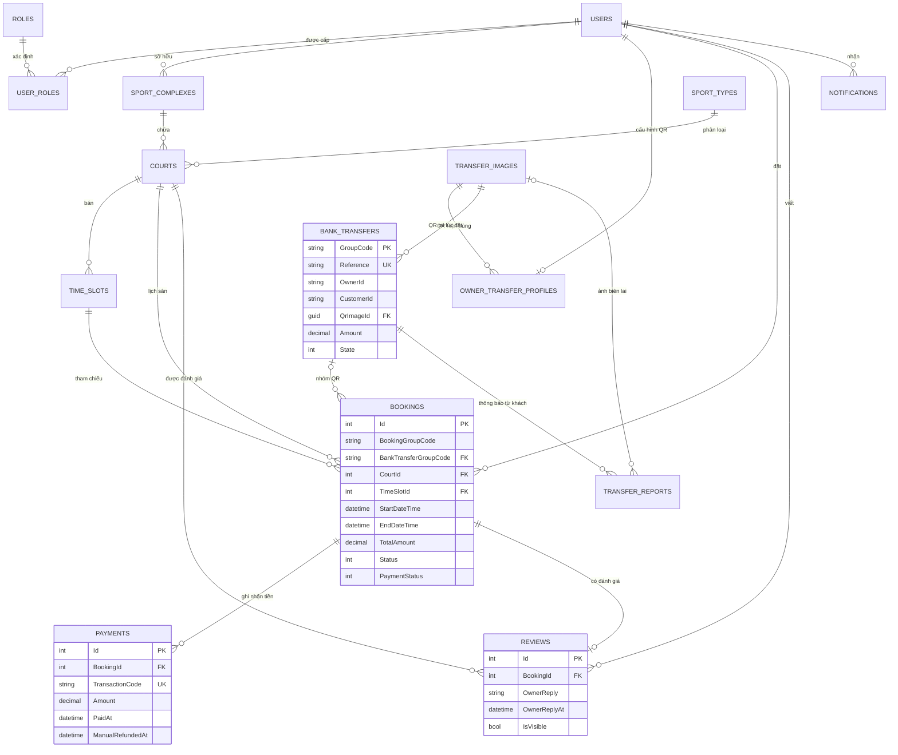
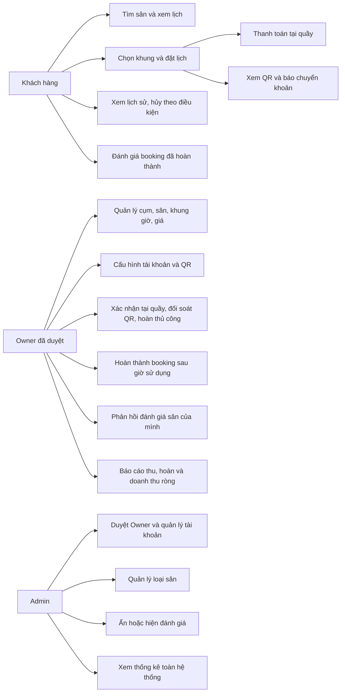

# ERD và use case SportBooking

Mô hình lấy từ `ApplicationDbContext` và migration hiện tại. Các cột nhạy cảm của Identity và thành phần kỹ thuật được lược bớt để đọc sơ đồ.

Mỗi booking là một khung. Giờ và giá được chốt trên booking. `BankTransfer` giữ danh tính theo nhóm và tham chiếu ảnh QR tại lúc đặt. Các trường `OwnerId`, `CustomerId` trên nhóm chuyển khoản là dấu vết quyền sở hữu trong ứng dụng. `DemoSeedStates` ghi dấu hoàn tất seed.

## Use case theo vai trò

Admin, Owner và khách đăng nhập bằng Identity. Các thao tác ghi đi qua POST có CSRF. Owner quản lý dữ liệu theo quyền sở hữu ở server. [Trạng thái và quy tắc](BUSINESS_RULES.md)
